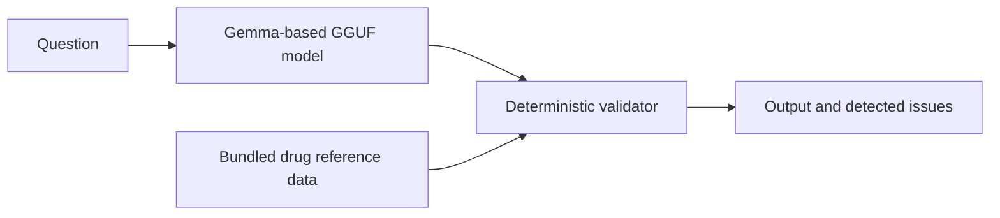

# IatrogeniX

A medical language-model research project combining a Gemma-based fine-tune, local GGUF inference and a deterministic output validator. Built with AI assistance for the Kaggle “Gemma 4 Good” hackathon.

[Model artifact](https://huggingface.co/kayomarz97/IatrogeniX) · [Four-way ablation](docs/ablation_study.md) · [Evaluation limitations](docs/evaluation-status.md)

The engineering question is how much fine-tuning and a separate rule layer each change model behaviour. The existing results show useful failure modes, including answer-position bias; they do not establish clinical safety or a global model ranking.

## Architecture



The inference service exposes raw generation at `/generate` and generation with output checks at `/generate/safe`. The validator checks a bounded list of fictional names, dose patterns and overconfident wording. Some evaluation checks can also compare against a supplied reference answer; that reference is not available for ordinary user questions.

A `safe` status means these implemented checks did not flag the output. It does not mean the answer is medically correct or safe to act on.

## What the existing evaluation reports

The checked-in [four-way ablation report](docs/ablation_study.md) describes 1,000 cases from a mixed medical-question suite. These are previously reported internal results, not a new independent rerun.

| Configuration | Extracted-letter accuracy | Similarity ≥ 0.6 |
|---|---:|---:|
| Fine-tuned model, validator on | 36.7% | 51.4% |
| Fine-tuned model, validator off | 37.2% | 52.0% |
| Base model, validator on | 43.6% | 22.0% |
| Base model, validator off | 43.6% | 22.1% |

The second metric is the proportion of outputs above an SBERT cosine-similarity threshold. It is not standard MCQ accuracy and is not directly comparable with MedQA leaderboard scores. The fine-tuned model scores lower on extracted-letter accuracy than the base in this report; the report identifies positional bias as a failure mode.

The old **83.1% / global #1** headline is withdrawn pending substantiation. The earlier comparison report contains fixed reference scores, a zero-item baseline and no per-question comparison records. It does not demonstrate a controlled leaderboard result. Historical documents may still contain those earlier claims; use this README and the limitations note as the current status.

No new hosted ARC-Challenge score is available. A pinned ARC evaluation would measure general science reasoning of the model artifact, not clinical safety or the separate Python validator.

## Try the model locally

Download `iatrogenix-q5_k_m.gguf` from the [model repository](https://huggingface.co/kayomarz97/IatrogeniX/tree/main) into a local `models/` directory. The artifact revision inspected for the pending hosted benchmark is `2c126966cdc121ec497ea805718a3a227f774959`.

The repository's `requirements.txt` combines training and inference packages. For an inference-only environment, install the relevant runtime dependencies in an isolated environment:

```bash
python3 -m venv .venv
source .venv/bin/activate
pip install llama-cpp-python fastapi uvicorn
export IATROGENIX_MODEL="models/iatrogenix-q5_k_m.gguf"
uvicorn inference.engine:app --host 127.0.0.1 --port 8000
```

Use a llama.cpp / llama-cpp-python build compatible with the model's architecture. Installation and hardware requirements depend on the runtime; the commands above have not been rerun as part of this documentation correction.

```bash
curl -X POST http://127.0.0.1:8000/generate/safe \
  -H 'Content-Type: application/json' \
  -d '{"question":"Explain how this research model handles uncertainty."}'
```

Do not supply a reference answer for a deployment-representative validator test. Evaluate model-only and validator-on configurations separately.

## What needs measuring next

- A complete pinned run with the model revision, artifact, harness commit, task version, prompt format, seed, few-shot count and full scores retained.
- An identical base-model run before making improvement claims.
- A validator-on evaluation without access to reference answers, with both missed issues and unnecessary warnings counted.
- A held-out medical evaluation with a documented split, standard scoring and a training-data overlap check.

## Repository map

- `inference/`: FastAPI service and GGUF loading.
- `safety/`: rule-based validator and bundled reference data.
- `evaluation/`: existing harnesses and result files.
- `docs/ablation_study.md`: prior four-way ablation and failure analysis.
- `docs/evaluation-status.md`: evidence limits and interpretation.

Research and portfolio demonstration only. Do not use this project to make medical decisions.
